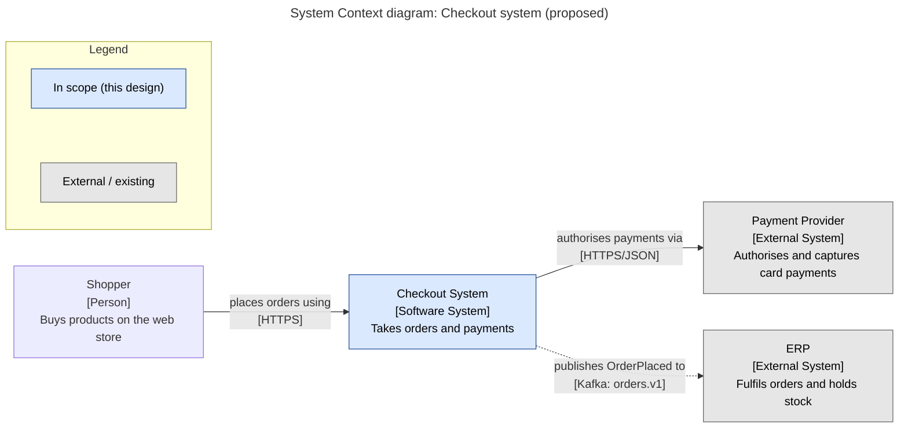
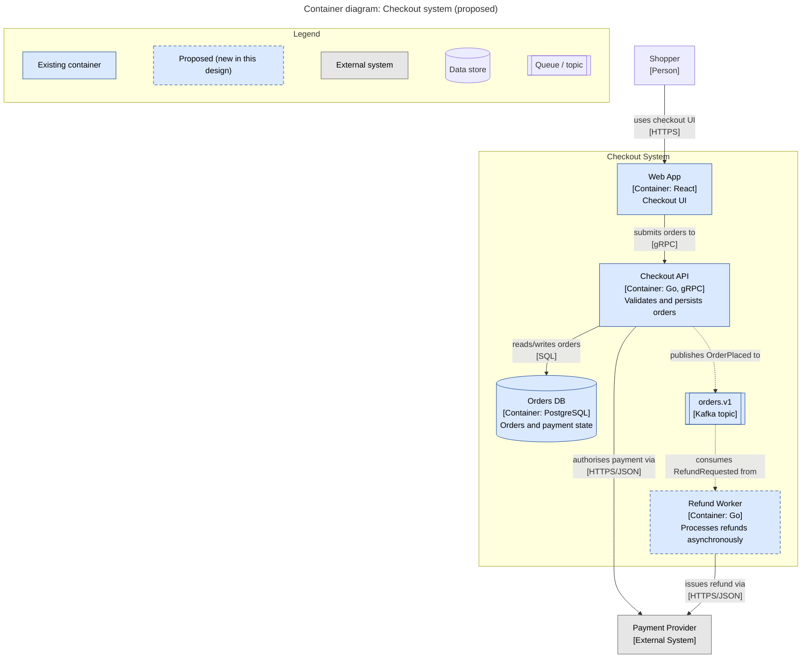
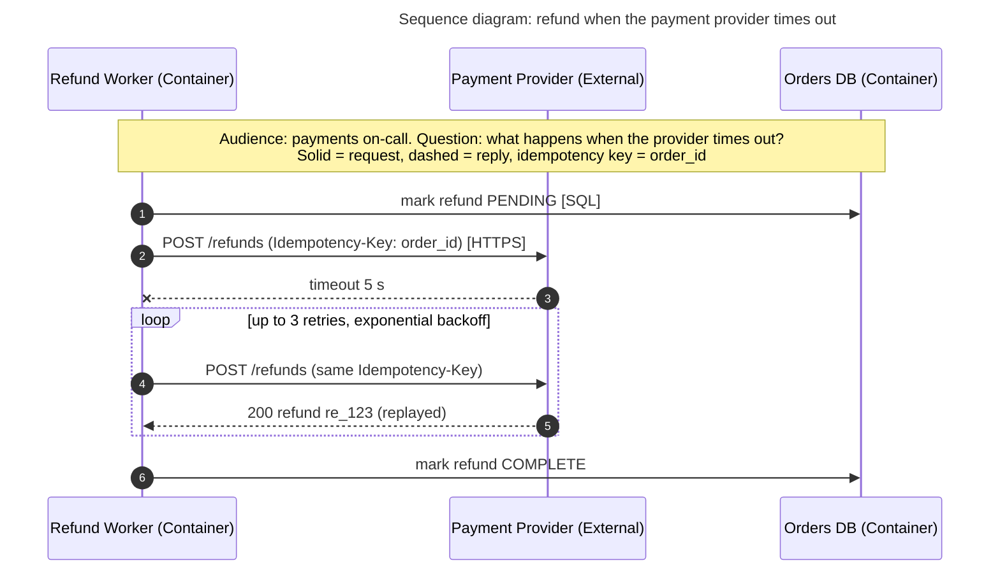
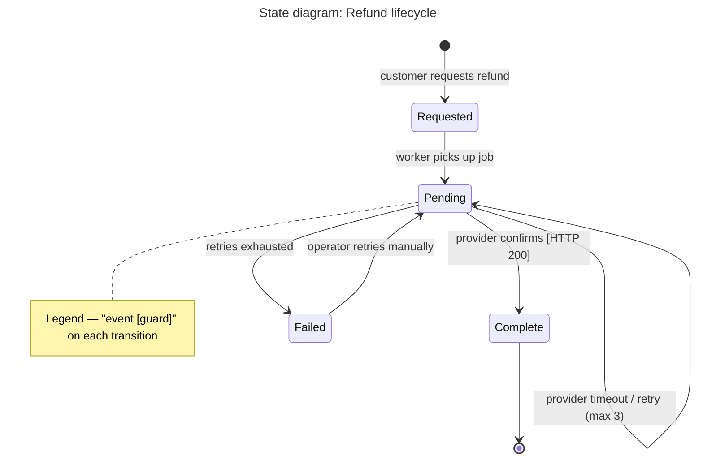
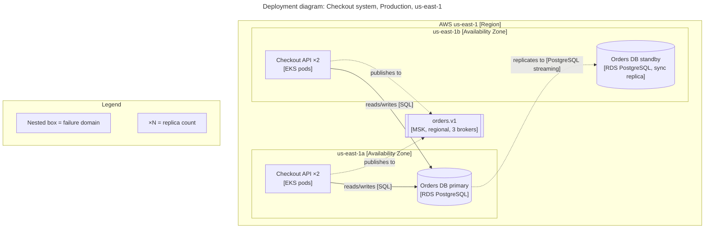

# Mermaid starter snippets

Each snippet already carries a title, a legend, typed elements and verb-labelled arrows with protocols. Copy, rename, and delete what you don't need. Mermaid has no native legend, so the legend is a small subgraph (structural diagrams) or a `Note` (sequence diagrams). Keep it whenever the diagram uses colour, dashed lines or dashed borders to mean something; drop it from a plain sequence diagram that uses only ordinary request and reply lines.

Syntax gotchas (verified with mermaid-cli 11): sequence-diagram participant aliases cannot contain square brackets, and semicolons inside labels or notes are read as statement separators, so use parentheses and commas there.

Conventions used throughout:
- Solid arrow `-->` = synchronous call, initiated by the source.
- Dashed arrow `-.->` = asynchronous message or event.
- Dashed border (`stroke-dasharray`) = proposed / new in this design.
- In **sequence diagrams** Mermaid itself draws replies dashed (`-->>`), so "dashed = async" does not hold there. State the sequence-diagram convention separately in its note: solid = request, dashed = reply, `-)` = async fire-and-forget message.
- Grey fill = external or existing, out of scope for the change.

## System Context (C4 level 1) as a flowchart

## Container (C4 level 2) as a flowchart

Legend text should also state: "solid arrow = synchronous call in the direction of the initiator; dashed arrow = asynchronous message." Every shape the diagram uses (cylinder for data stores, double-bracket for queues) gets a legend entry, as above.

## Sequence diagram (one scenario, including the failure path)

## State machine

## Deployment (nested nodes)

Pair the deployment diagram with a "what happens when X fails" table in prose (AZ loss, DB primary loss, broker loss).
