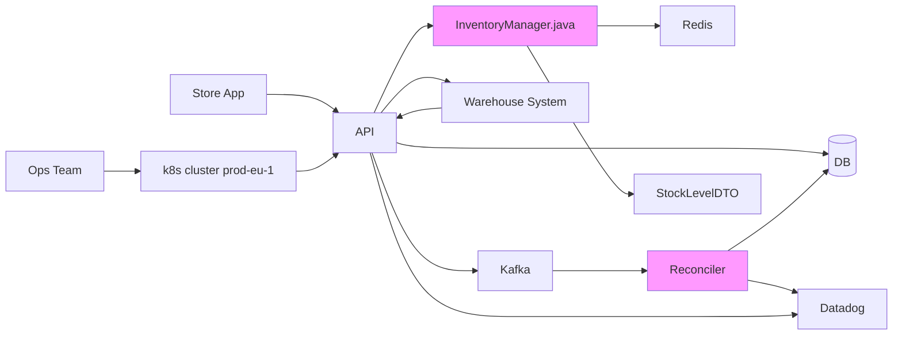

# Inventory Sync v2 — design

## Architecture

Here's the overall architecture:

The Reconciler is new. It fixes the drift we see between our DB and the warehouse every night. It uses Kafka. Everything else already exists.

## Rollout
Enable per region behind a flag.
